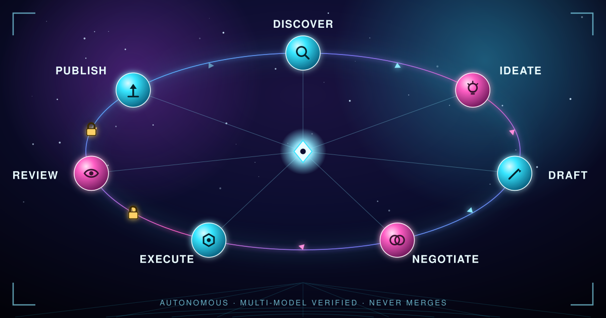
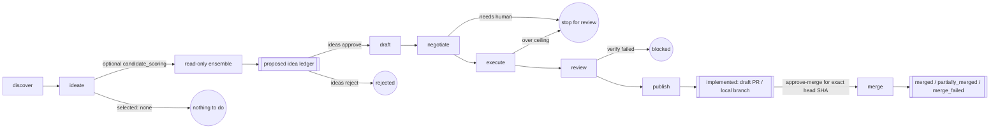

# e3d-pilot

**Multi-model AI problem solving: independent answers → critique → convergence → human decision → execution → review → provenance.**


e3d-pilot is an open-source system for getting multiple AI models to work on the same problem instead of trusting a single model's answer — from a one-off question to a fully executed, human-gated software change.

It starts simply. Ask several configured models (Claude, Codex, Grok, Devin, or others you wire in) the same question. Let them answer independently, see and critique each other's positions, revise, expose real dissent, and converge on the strongest answer. That's `bin/e3d-debate` — a standalone tool, no repo or pipeline required. It's also available inside your editor as an MCP server: [use it from GitHub Copilot, Claude Code, or Cursor](#use-e3d-pilot-from-github-copilot-claude-code-and-cursor-mcp) with one `npx` line.

Then e3d-pilot takes the same instinct further, into real software work: `discover → ideate → approve → draft → negotiate → execute → review → publish → outcome`. Every step is preserved in an append-only ledger, so the system (or a human, or a fresh AI session) can later reconstruct where an idea came from, which models or people influenced it, what it produced, and what happened afterward.

## Try e3d-debate in 60 seconds

```bash
git clone https://github.com/spacepacket1/e3d-pilot.git
cd e3d-pilot

bin/e3d-debate \
  "Should e3d-pilot's provenance data be a graph, or is that over-engineering?" \
  --providers claude,codex --rounds 3
```

(Any `lib/providers/<name>` adapter can join — add `devin`/`grok-build`/others if you have them configured; `claude`/`codex` are the two most people trying this will already have.)

Round 1: every provider answers independently. Round 2+: each sees the others' prior-round positions and must defend, revise, rebut, or concede. The debate stops early if they genuinely converge; a synthesizer then reads the full transcript and reports a final answer, consensus, and any remaining dissent.

That question isn't hypothetical — it's a real debate we ran this way, condensed from the [full transcript](docs/debates/2026-09-07-e3d-graph-generalization/transcript.md):

```text
QUESTION
Should the E3D 3D graph generalize into a standalone product, or should
e3d-pilot instrument its own provenance instead?

CLAUDE (round 3, the only one to formally reach "approved")
Don't create e3d-graph yet — build a confidence-annotated, domain-neutral
provenance emitter inside e3d-pilot, prove attribution questions are
answerable from the data alone, add a 2D lens only if they are, and extract
a public repo only on external pull or paid demand.

CODEX (round 3)
Build outcome-linked Pilot provenance first, then open-source a narrow
standalone viewer only if measured workflow value and external pull
justify extraction.

DEVIN (round 3)
Instrument Pilot with a domain-neutral provenance schema from day one; gate
public extraction on the internal experiment succeeding, not on indefinite
deferral.

GROK-BUILD (round 3)
Do not ship standalone e3d-graph; instrument Pilot provenance first and
treat visualization as a 2D lens inside E3D.

SYNTHESIS
Do not ship a standalone e3d-graph product. Instrument e3d-pilot now with
an append-only, domain-neutral, confidence-annotated provenance schema —
the ledger stays canonical, the graph is an index, not memory. Validate by
answering real attribution questions from the data alone before any UI.

DISSENT (reported, not hidden)
Devin and partly Codex would gate public extraction on the internal
experiment succeeding; Claude and Grok-build require external pull or paid
demand instead — a real, named disagreement the tool didn't paper over.
```

**What happened next:** we built exactly that, then ran it against three real ideas in this repo's own history. All three came back "more useful than reading the raw ledger by hand" — and one of them caught a real error in the spec that proposed it. Later graph-intelligence queries were evaluated just as honestly: one clear win, two explicitly "no signal" because the real data was still too sparse — reported as-is, not oversold. That full arc (spec, dogfood results, the honest misses) is in [`docs/provenance-graph-experiment.md`](docs/provenance-graph-experiment.md) and [`docs/graph-intelligence-experiment.md`](docs/graph-intelligence-experiment.md).

**Experimental: the provenance graph.** e3d-pilot now derives structural relationships — ideas, actors, models, decisions, repos, commits, evidence, outcomes — from its own immutable event ledger. We're testing whether that graph reveals patterns that are genuinely hard to get from the raw ledger, not claiming it already does.

You don't need the rest of e3d-pilot to use `e3d-debate` on its own — see [e3d-debate](#e3d-debate-experimental) below for the full flag reference. Keep reading for the part that takes a debate's answer all the way to a shipped, reviewed, provenance-tracked change.

## Use e3d-pilot from GitHub Copilot, Claude Code, and Cursor (MCP)

`e3d-mcp` is a zero-dependency [Model Context Protocol](https://modelcontextprotocol.io) server. It lets an AI coding assistant ask for a multi-model second opinion mid-task, instead of committing to the first answer one model gives it. It's published on npm as [`e3d-pilot`](https://www.npmjs.com/package/e3d-pilot) and listed in the official MCP registry as `io.github.spacepacket1/e3d-pilot`.

| Tool | What it does |
| --- | --- |
| `e3d_debate` | Several independent models answer and a synthesizer returns a decisive answer, a consensus level (`full` / `majority` / `split`), any named dissent, and each model's final position, as both readable text and structured data (`dissent.present`, `dissent.summary`, `positions`). `mode: "quick"` (default) is one round and takes seconds; `mode: "thorough"` adds a critique round where models rebut each other. The full transcript is opt-in (`include_transcript`). |
| `e3d_list_providers` | Shows which model providers are available on this machine. A debate needs at least two. |
| `e3d_provenance_trace` | Read-only: traces why a change exists, from its origin through debates, approvals, execution, review, and outcome. |
| `e3d_ideas_list` | Read-only: lists the ideas e3d-pilot tracks in a repo, to find an id for the trace. |

A real result in `quick` mode (11 seconds, two models), from asking whether a small CLI should default to a flat JSON file or SQLite:

```text
FINAL ANSWER: Default to a flat JSON file for a small CLI. It has no dependencies, is
human-readable and diffable, and is easy to hand-edit and debug. Write it atomically
(temp file, then rename). Move to SQLite once you need indexed queries, concurrent
writers, or data beyond a few MB.
CONSENSUS: split
DISSENT: Codex prefers SQLite as the default for any persistent mutable state because
it gives transactions, concurrency safety, and schema evolution at low cost.
```

The disagreement is the point: you get the answer and the strongest case against it, instead of one model's confident guess.

### Install

**VS Code (GitHub Copilot agent mode):** [one-click install](https://insiders.vscode.dev/redirect/mcp/install?name=e3d-pilot&config=%7B%22command%22%3A%22npx%22%2C%22args%22%3A%5B%22-y%22%2C%22--no-update-notifier%22%2C%22-p%22%2C%22e3d-pilot%22%2C%22e3d-mcp%22%5D%7D), or add this to `.vscode/mcp.json`:

```json
{
  "servers": {
    "e3d-pilot": { "type": "stdio", "command": "npx", "args": ["-y", "--no-update-notifier", "-p", "e3d-pilot", "e3d-mcp"] }
  }
}
```

**Claude Code:**

```bash
claude mcp add e3d-pilot -- npx -y --no-update-notifier -p e3d-pilot e3d-mcp
```

**Cursor** (`~/.cursor/mcp.json`) and other clients that use the `mcpServers` shape:

```json
{ "mcpServers": { "e3d-pilot": { "command": "npx", "args": ["-y", "--no-update-notifier", "-p", "e3d-pilot", "e3d-mcp"] } } }
```

Any MCP client that can launch a stdio server should work; the shapes above are each client's standard format.

**Prerequisites:** Node 18+, `jq`, bash 4+ (macOS ships 3.2: `brew install bash jq`), and at least two model CLIs logged in (e.g. `claude` and `codex`). Check them all at once:

```bash
npx -y -p e3d-pilot e3d-mcp --doctor
```

`--doctor` reports what's missing and how to fix it. It does not need the full pipeline's `e3d-code` executor (it only notes whether that is installed). From a clone, `bin/e3d-mcp --print-config --local` prints a config that points at your checkout.

### Using it

In Copilot agent mode (or any client), ask: *"Before you pick a storage layer, run e3d_debate on SQLite vs flat JSON for this CLI."* To make the assistant do this unprompted for contestable design choices, copy [examples/copilot-instructions.md](examples/copilot-instructions.md) into `.github/copilot-instructions.md` or `AGENTS.md`. Don't use it for lookups or questions with an obvious answer; it is slow and costs money.

### Cost and limits

- `quick` debates take seconds to a minute and `thorough` ones a few minutes; both spend **your** model credits. The server caps `e3d_debate` with `E3D_MCP_MAX_ROUNDS` (3), `E3D_MCP_MAX_PROVIDERS` (4), `E3D_MCP_MAX_CONCURRENT` (2), and `E3D_MCP_TIMEOUT_SEC` (900).
- It uses whatever provider CLIs and keys are in the server's environment (see `e3d-pilot providers list`).
- The Copilot *coding agent* runs on GitHub-hosted runners, where those provider CLIs aren't installed. Use the local (stdio) setup above for now.
- `e3d_debate` and the read-only tools never write to a repo. The pipeline tools below do, only through the same gated CLI paths as a person would, and `e3d_pilot_propose` writes to the repo's `.e3d-pilot/` ledger.

### Run the pipeline from your editor

> **Status (0.2.0):** the pipeline tools and the sampling default are new. They are tested with scripted MCP clients and fake providers, not yet verified inside a real VS Code Copilot session. Approving from the editor is off unless you set `E3D_MCP_ALLOW_APPROVAL=1`, and the pipeline tools only touch repositories you allow.

Besides debates, `e3d-mcp` can drive the human-gated pipeline, so an assistant can go from a decision to a draft PR without leaving the editor. The tools call the same CLI code paths a person would; they never reimplement a stage or weaken a gate.

| Tool | Cost | What it does |
| --- | --- | --- |
| `e3d_pilot_config_check` | free | Validates `.e3d-pilot/config.json` and reports whether `e3d-code` (the code-writing executor) is installed. |
| `e3d_pilot_propose` | free | Records an idea in the repo's ledger, optionally attaching an `e3d_debate` result as provenance evidence. |
| `e3d_pilot_start` | **spends credits** | Starts `discover` or `ideate` as a background job. (`all` is not offered: it would run past the plan preview.) |
| `e3d_pilot_job_status` | free | State, stage reached, artifacts, and log tail of a job. Jobs live on disk under `.e3d-pilot/mcp-jobs/` and survive server restarts. `wait_seconds` waits for a job to settle. |
| `e3d_pilot_approve` | gate | **Human gate 1.** Read-only by default: returns `waiting_for_human` and the exact command to run (see the trust model). |
| `e3d_pilot_reject` | gate | Rejects a proposed idea. Confirmed in the editor, or with an exact `confirm_phrase`. |
| `e3d_pilot_implement` | **spends credits** | For an approved idea: drafts the spec and has reviewers negotiate it, then **pauses before any code is written**. |
| `e3d_pilot_code_plan` | free | Shows what execute would do: each phase, the runner and model, files touched, verify commands, preflight result. Returns a `plan_token`. |
| `e3d_pilot_execute` | **spends credits, writes code** | Needs a fresh `plan_token` for exactly that spec. Writes code in an isolated worktree on its own branch, verifies, reviews, opens a **draft** PR. |
| `e3d_pilot_cancel_paused` | free | Abandons a paused implementation (records a failed attempt with your reason). |
| `e3d_pilot_request_changes` | gate | After a draft PR exists, sends the idea back for rework. |
| `e3d_pilot_artifact` | free | Reads one run artifact from a fixed list (spec, negotiation log, review, per-phase results from the `e3d-code` manifest), size-capped and redacted. |

**A worked flow from Copilot agent mode**

1. *"We need local persistence. Run `e3d_debate` on JSON vs SQLite."* The verdict comes back with its dissent.
2. *"Propose that as an idea, with the debate as evidence."* `e3d_pilot_propose` records it as `proposed`.
3. *(optional)* `e3d_pilot_start` with `discover` then `ideate` to have the pipeline find ideas for the repo itself.
4. **You approve it** (see below). Nothing is drafted or written before this.
5. *"Implement it."* `e3d_pilot_implement` drafts and negotiates a phased spec, then pauses. Poll `e3d_pilot_job_status`.
6. *"Show me the plan."* `e3d_pilot_code_plan` lists each phase with its model, the files it touches, and the verify commands.
7. If it looks right: `e3d_pilot_execute`. If not: `e3d_pilot_cancel_paused`. Execution ends with a draft PR for a person to review.
8. **Merging is not available over MCP.** `approve-merge` and `merge` stay CLI-only on purpose, so the last gate is always a person at a terminal (or the web UI).

**Trust model**

- **Gate 1 is a person's decision.** `e3d_pilot_approve` does not approve by default. If the server operator sets `E3D_MCP_ALLOW_APPROVAL=1` *and* the editor supports MCP elicitation, it asks the person in the editor's own prompt; an agent cannot answer that prompt for them. Without both, it returns the command to run (`e3d-pilot ideas approve ...`) or you can use the web dashboard.
- `confirm_phrase` alone would only prevent accidents (an agent can read it from an error message), which is why it is not the approval mechanism. `reject` and `request_changes` accept it because they only stop work.
- **The CLI enforces approval itself.** Every mutating stage checks a digest-bound approval inside the stage, so no tool here can skip it.
- **Repo allowlist.** Pipeline tools only operate on `E3D_MCP_REPOS` (a `:`-separated list), the client's workspace folders, or, if neither exists, the git repository the server was started in. Paths are resolved through symlinks, must be a git repository's top level, and anything outside is rejected. (The four original tools predate this and are unchanged.)
- **Code is written in a separate worktree** on a per-run branch, under the existing `protected_paths`, `max_diff_files`/`max_diff_lines` ceilings and verify-before-publish rules. Your working tree is untouched.
- Logs, artifacts and errors pass through secret redaction.

**Cost model**

- Tools say in their descriptions whether they are `FREE` or `SPEND MODEL CREDITS`. `code_plan` uses `e3d-code --list` and `--preflight` only, which write nothing (`--dry-run` is deliberately avoided because it records a "completed" phase in the manifest).
- Caps: one job per repo at a time, `E3D_MCP_MAX_JOBS` (2) across repos, `E3D_MCP_JOB_TIMEOUT_SEC` (3600), `E3D_MCP_MAX_PHASES` (8), plan tokens expire after `E3D_MCP_PLAN_TTL_SEC` (1800) and are void if the spec or the repo's HEAD changes.
- There is still no per-day or per-session spend cap and no cost reporting. Treat the caps above as guardrails, not a budget.

**Copilot's own models by default**

When the client supports MCP *sampling* (VS Code does, per its docs), `e3d_debate` uses the client's own models (Copilot) as one or two of its voices and adds any model CLIs it detects on the machine (`claude`, `codex`, `gemini`, ...), instead of requiring two CLIs. The first request prompts you to authorize the server to use your models; you can restrict which in *MCP: List Servers > Configure Model Access*. Results report which models actually answered and warn when every voice resolved to the same model (that is one model arguing with itself, not a debate). Without sampling, the default is the original `claude` + `codex`. Pin it with `E3D_MCP_PROVIDERS=claude,codex`, or cap it with `E3D_MCP_AUTO_VOICES`. Sampling spends your Copilot usage.

Sampling can only answer text-in, text-out prompts, so it works for debates and for the `negotiate` and `review` stages if you name `mcp-sampling` in a repo's `providers`. `discover`, `ideate`, `draft` and `execute` must read or edit the repository and still need a model CLI. `e3d_pilot_config_check` warns about this. A job that uses a sampling provider fails if the editor or server stops mid-run.

**If something doesn't work in VS Code** (observed in a real run on VS Code 1.142 with the built-in Copilot Chat):

- The "Start" code lens may show only "e3d-pilot Error". The reason is in VS Code's agent-host log: newer builds will not start an MCP server until a chat session exists ("Cannot start an MCP server before the session runtime has been created. Send a message first."). Open Chat, send any message, then start or restart the server.
- VS Code may show a one-time "migration" message that empties `.vscode/mcp.json` and writes a `.mcp.json` in a different format (`mcpServers`, `type: local`, `tools: ["*"]`). If your server vanished, check which file VS Code is reading, or restore `.vscode/mcp.json` from `e3d-mcp --print-config`. Local stdio servers may also require the "Local" chat session type.
- The permission prompt to let the server use your models appears on the first **debate**, not on `e3d_list_providers` (which calls no model).
- `e3d-mcp --doctor` may say no separate Copilot extension is listed. Recent VS Code builds include Copilot Chat built in, so that is expected.
- The daily budget resets at **00:00 UTC** (5 PM Pacific during daylight time), so its "day" can differ from your local date. `e3d_usage` shows the exact `resets_at`.
- While an implementation is paused, the idea's ledger status is still `implementing`; the job reports `waiting_for_human` with `paused_before`. After `e3d_pilot_cancel_paused` or `e3d_pilot_execute`, that job is marked `cancelled` or `resumed`.
- Ledger entries made through MCP, including the first `idea_proposed` event, are attributed to `mcp:<client>` (or `E3D_MCP_ACTOR`), never to the git identity of whoever owns the checkout. `<client>` is the name the editor announces: VS Code announces itself as `Visual Studio Code`, but Copilot's agent host announces `copilot-cli`, so the actor reads `mcp:copilot-cli` there. Set `E3D_MCP_ACTOR` if you want a fixed name. A declined approval is recorded as a note on the idea.
- **Declining at VS Code's own tool-call confirmation never reaches the server**, so nothing can be recorded. Only the "Approve this idea?" form the server shows is recorded (as a note). VS Code may log `response=accept` for that form even when you decline, so the idea's ledger notes are the reliable place to see the difference.
- **Debates reserve their worst case before running and settle to what they actually used**, atomically (a lock file serializes several server processes sharing one counter), so simultaneous requests cannot all pass the same cap.
- **Spend is counted for pipeline jobs too.** `e3d_pilot_start`, `e3d_pilot_implement` and `e3d_pilot_execute` reserve an estimated number of model calls and tokens against the daily budget before they start (a discover/ideate start about 2 calls per configured provider, implement one call per drafter plus two per negotiation reviewer, execute 3 calls and about 200,000 tokens per phase; tune with `E3D_MCP_EST_TOKENS_PER_PHASE`). A reservation that would break a cap refuses the job and records nothing; a job that cannot start gives its reservation back. These are estimates, not measurements.
- **The usage counter is machine-wide**, not per repository: one file per principal (`local` over stdio) under `~/.e3d-pilot/usage/`, shared by every repo the server touches. `e3d_usage` shows the file path. Delete it to reset the day.
- When the editor's own models answer (MCP sampling), a debate stops after 150 seconds (`E3D_MCP_SAMPLING_TIMEOUT_SEC`) so the server reports the timeout before the editor gives up at about 3 minutes. Only calls that actually answered are counted; a debate stopped before its verdict is not charged for a synthesis call it never made.
- A failed implementation names its real cause in the job's `failure_detail` (for example `draft-rejected.md: status: too-large ...`), and the stored job record carries a `warnings` list. After a cancel, the status says the log is history.
- `e3d-mcp` also offers MCP prompts (`/e3d-debate`, `/e3d-propose`, `/e3d-budget` in editors that show them), and the server reports the version in `package.json` (a development build reports `0.2.0-dev.N`).
- Agents reach the tools more reliably when the repository tells them when to use them. Copy [docs/mcp-agent-instructions.md](docs/mcp-agent-instructions.md) into `.github/copilot-instructions.md` or `AGENTS.md`.
- A debate result now reports vendor families: Copilot's Claude plus the `claude` CLI count as one family, and overlap is called out in `warnings`.

| Variable | Default | Meaning |
| --- | --- | --- |
| `E3D_MCP_REPOS` | workspace roots | `:`-separated repos the pipeline tools may use. |
| `E3D_MCP_ALLOW_APPROVAL` | off | `1` lets a person approve from the editor via elicitation. |
| `E3D_MCP_ACTOR` | `mcp:<client>` | Actor name recorded in the ledger for MCP actions. |
| `E3D_MCP_MAX_JOBS` / `E3D_MCP_JOB_TIMEOUT_SEC` | 2 / 3600 | Concurrent jobs, per-job timeout. |
| `E3D_MCP_MAX_PHASES` / `E3D_MCP_PLAN_TTL_SEC` | 8 / 1800 | Phase cap for execute, plan lifetime. |
| `E3D_MCP_MAX_ARTIFACT_BYTES` | 100000 | Largest artifact read. |
| `E3D_MCP_SAMPLING_TIMEOUT_SEC` | 150 | Stop a debate that uses the editor's models after this long. |
| `E3D_MCP_EST_TOKENS_PER_PHASE` | 200000 | Tokens reserved per code-writing phase when `e3d_pilot_execute` starts. |
| `E3D_MCP_PROVIDERS` / `E3D_MCP_AUTO_VOICES` | auto / 3 (2 without sampling) | Pin or cap the default debate voices. |
| `E3D_MCP_SAMPLING_HINTS` | `claude,gpt` | Model-name hints for the two sampling voices. |

Add them to the server's `env` in `mcp.json`, e.g. `"env": { "E3D_MCP_REPOS": "/Users/me/work/app" }`.

### Hosted / remote use

`e3d-mcp --http [--host H] [--port N]` serves the same server over MCP's streamable HTTP transport, and `deploy/Dockerfile` packages it as a container, so clients that cannot run local tools (such as the Copilot coding agent) can still request debates. **Nothing is deployed:** no cloud account has been used, and the AWS and Azure notes in [deploy/README.md](deploy/README.md) are untested.

- **Who pays:** the operator's model credentials (Azure OpenAI, Bedrock, or a local endpoint, via the `azure-openai`, `bedrock`, `anthropic-api` and `openai-api` providers), not the caller's. Each bearer token (`E3D_MCP_AUTH_TOKENS="name:token"`) is a budget principal with a daily call and estimated-token cap, checked before a debate starts. These caps are per token, not global, and live in files on one instance.
- **What is off over HTTP, and why:** the `e3d_pilot_*` pipeline tools, provenance and idea listing (they act on repositories on the server's disk) are hidden by default; sampling, elicitation and roots are disabled (they need server-to-client requests), so approvals stay read-only. A non-loopback bind refuses to start without tokens, and TLS is expected from a reverse proxy.
- **Usage reporting also works locally:** `e3d_debate` results now include `usage` (model calls and estimated tokens) and `budget`, `e3d_usage` shows today's totals, and `E3D_MCP_DAILY_CALLS` / `E3D_MCP_DAILY_EST_TOKENS` set optional caps in stdio mode too (unlimited by default there).

### Hosting with an external auth and metering service

Use this when you host `e3d-mcp --http` for paying customers and a billing service (yours) owns the keys and the balances. The server then asks that service who a caller is (`introspect`), holds credits before a debate (`reserve`), and reports what really happened (`settle`, or `release` when nothing ran). Without it, the static `E3D_MCP_AUTH_TOKENS` and the local daily caps work exactly as before. The wire protocol, schemas, state machine and an implementer's checklist are in [docs/external-auth.md](docs/external-auth.md); a reference stub (`examples/external-auth-stub.js`, not production code) and a conformance runner (`examples/external-auth-conformance.js`) show and test a compatible service:

```
STUB_SERVICE_TOKEN=<24+ chars> STUB_RESERVATION_TTL_SEC=2 node examples/external-auth-stub.js   # prints its loopback URL; the runner's expiry vector needs a short hold lifetime
node examples/external-auth-conformance.js <that URL> <token>          # run against any implementation
```

**The hook checks identity and spend. It does not make the code-writing tools safe to expose to customers**; keep the `e3d_pilot_*` pipeline tools off for them.

| Variable | Default | Meaning |
|---|---|---|
| `E3D_MCP_AUTH_URL` | unset | Base URL of the service (https, or http on loopback). Setting it turns the hook on; `--http` only. |
| `E3D_MCP_AUTH_SERVICE_TOKEN` | none | The server's own credential for the service (24+ printable characters). |
| `E3D_MCP_AUTH_SERVICE_TOKEN_FILE` | none | Same, read from a file (mode 0600). Set one of the two, not both. |
| `E3D_MCP_AUTH_CACHE_SEC` | 30 | How long an active `introspect` answer is cached (1 to 300). This is the maximum revocation latency. |
| `E3D_MCP_AUTH_MAX_INFLIGHT` | 32 | Distinct `introspect` calls in flight at once (1 to 1024). |
| `E3D_MCP_AUTH_IP_PER_MIN` | 30 | Rejected (unknown or malformed) keys one IP may present per minute before further unknown keys are refused without asking the service. Successful keys do not count. |
| `E3D_MCP_AUTH_HEALTH_SEC` | 15 | Interval of the background `health` probe behind `/readyz`. |
| `E3D_MCP_OUTBOX_MAX` | 5000 | Undelivered settlements allowed before new billed work is refused. |
| `E3D_MCP_ORPHAN_MAX_AGE_SEC` | 21600 (positive whole seconds; anything else refuses to start) | Age after which an unfinished debate's metering intent is reconciled even if its process id looks alive (pids are reused after crashes). |
| `E3D_MCP_TRUST_PROXY_HOPS` | 0 | Number of trusted reverse proxies in front of the server. With N, the failed-key limiter uses the Nth entry from the right of `X-Forwarded-For` as the client address instead of the proxy's address; 0 ignores the header. |
| `E3D_MCP_AUTH_KNOWN_ACTIVE_MAX` | 10000 | How many recently-active keys the failed-key limiter remembers (oldest evicted first). |
| `E3D_MCP_OUTBOX_MAX_DEAD` | 1 | Dead-lettered settlements tolerated before new billed work is refused; retry or resolve them with `--outbox-status` and `--outbox-retry-dead`. |
| `E3D_MCP_OUTBOX_CLAIM_SEC` | 300 | A delivery claim older than this belongs to a crashed process and is retried. |
| `E3D_MCP_ORPHAN_POLICY` | `charge` | What a debate that was running when the server crashed costs on restart: `charge` (the reserved units, outcome `orphaned`) or `release`. A crash before the debate started (reservation made, models not yet called) always just releases the hold. |

- **Fails closed.** If the service cannot be reached or answers badly, the request is refused (HTTP 503 `retry-after: 5`, or 401 for an inactive key) and no model runs. Settlements that cannot be delivered are written to a durable outbox in the state directory and retried; nothing is dropped.
- **Local caps stay a second ceiling.** `E3D_MCP_DAILY_CALLS`, `E3D_MCP_DAILY_EST_TOKENS` and the rate limits still apply per principal, so a billing fault cannot make spend unbounded.
- **Operator commands** (print only record ids, call names, ages and counts): `e3d-mcp --outbox-status`; `e3d-mcp --outbox-export <file>` (new file, mode 0600, pending and dead records with payloads, no tokens, for reconciliation); `e3d-mcp --outbox-retry-dead <record_id>` (moves one dead record back to pending, exact id only; the only command that changes anything). `e3d-mcp --doctor` and `e3d_usage` report the hook, health and outbox counts. `/readyz` is 503 while the service or the outbox is unhealthy.
- Dead-letter and outage procedures: [runbook in docs/external-auth.md](docs/external-auth.md#operator-runbook).

## Why we built this

Autonomous coding agents solved the *execution* half of the problem: point a good model at a good spec, and it will faithfully implement it. What's still missing is everything **before** that — noticing what's worth building, making sure it isn't a rehash of a closed PR or last week's abandoned branch, and getting more than one model to actually agree the plan is safe and sound before anything touches a working tree. Skip that half and you get agents that happily reimplement existing features, argue with themselves in a PR nobody asked for, or quietly blow through a repo's real diff budget.

e3d-pilot exists to be that missing half: a small, auditable layer that sits *above* e3d-code (formerly spec2code) rather than duplicating it. e3d-code stays the dumb, reliable phase executor — "run this spec." e3d-pilot's job is deciding what the spec should even be, proving it's worth doing, and refusing to let it run unsupervised past the point where a human needs to look.

The other reason: good ideas rarely come from staring harder at the same backlog. e3d-pilot's discover stage explicitly borrows from domains outside a repo's own category — a game's progression loop, a marketplace's liquidity trick, a social feed's notification mechanics — and its ideate stage grades every candidate on attraction and retention (does this bring people in, does it bring them back) with revenue treated as a secondary tiebreaker, never the deciding factor. The goal is features people actually want, not just the next item on an internal TODO list.

A third reason, less about any single run and more about what accumulates across many of them: a decision made once shouldn't have to be re-explained from scratch to the next session that picks the work back up. Every tracked idea's ledger record is a durable, cross-session target — `ideas context`/`ideas handoff` let a fresh Claude Code, ChatGPT, or Codex session read exactly what's already known about an idea (its decisions, its findings, its current state) instead of replaying a whole prior conversation, and `ideas note` lets that session write back what it just learned. The same instinct — don't trust a single pass of reasoning on a genuinely contested question — is why `e3d-debate` exists as a standalone tool: run any question through several models across rounds until they converge or leave a named, specific dissent, the same mechanism e3d-pilot's own negotiate stage already depends on internally, available for any decision, not just code changes.

## What it does differently

- **Never repeats work.** Every idea is checked against the target repo's open branches, its PR history (open and closed), and every prior e3d-pilot run before it's allowed to proceed.
- **Never runs on one model's opinion.** The negotiate stage requires every configured reviewer — two today, more later, purely via config — to independently approve the same unchanged draft. Disagreement means bounded retries, then a clean "needs human" stop, not a forced merge.
- **Never treats absence of approval as approval.** Discovery and ideation can run unattended, but source-mutating stages require `ideas approve`, and base-branch merge requires `approve-merge` for the exact PR head SHA.
- **Never touches source before the first gate.** Execution happens in an isolated worktree on its own branch only after implementation approval. A path denylist and real post-execution diff ceilings are enforced before anything is reviewed or published.
- **Never merges a different revision.** Merge approval is separate from GitHub review approval and is bound to the observed PR URL, base branch, and head SHA. A pushed commit invalidates the approval until a human reviews and approves the new head.
- **Never assumes it's talking to spacepacket1's repos.** The entire contract with a target repository is one JSON config file. No fixed org, no fixed remote host, no `e3d-*` naming assumptions baked into the pipeline.
- **Never lets an idea's context evaporate between sessions.** `ideas note`/`ideas context`/`ideas handoff` give any AI session — not just e3d-pilot's own pipeline runs — a durable place to read and write what's been learned or decided about a tracked idea, independent of its lifecycle status.

## How it can help others

If you maintain a repository and want a standing second opinion on "what should we build next" — one that does its homework before proposing anything, gets independent model consensus before acting, and hands you a draft PR with a full audit trail instead of a fait accompli — adopting e3d-pilot is meant to be a one-file decision: write `.e3d-pilot/config.json`, run it once to validate, then point it at your repo (or a whole fleet of them) on whatever cadence you choose (a cron entry, a scheduled job — e3d-pilot doesn't invent its own scheduler). It works identically on GitHub, on a remote-less local repo, and — architecturally, even before a forge adapter exists for it — on any other git host, because only the final publish step knows what forge it's talking to.

## Pipeline





1. **discover** — writes `findings.md`: Git history, branches, issues/PRs, existing docs and TODOs, plus a model-researched "External Context" section that includes an explicit cross-domain "Analogous Patterns" subsection (see [Ideation sourcing](#ideation-sourcing-and-scoring) below).
2. **ideate** — writes ranked, deduplicated `candidates.md` and materializes every non-duplicate candidate as a `proposed` idea. `selected: none` is a valid, clean stop when everything proposed is already covered. If `candidate_scoring` is configured, an ensemble of read-only workers re-ranks non-duplicate candidates before materialization; the original model pick is stored as `model_selected`.
3. **approval gate 1** — a human approves or rejects the exact idea. `proposed` never means rejected, and no source-mutating stage can run without current implementation approval.
4. **draft** — turns the approved candidate into an e3d-code-shaped `spec-draft.md`, with machine-readable `pilot:touches` annotations per phase so later guards can check real paths instead of guessing from prose.
5. **negotiate** — every configured reviewer must approve the same unchanged draft in one pass; disagreement drives bounded revision rounds, ending in `spec-final.md` on success or a clean "needs human" stop.
6. **execute** — hands `spec-final.md` to the configured execute backend inside an isolated worktree on its own branch, then enforces `protected_paths` and the real post-execution `max_diff_files`/`max_diff_lines` ceilings. The default backend is e3d-code (formerly spec2code). `providers.execute: "grok-build"` is an experimental alternative that still uses the same worktree, ceilings, review, and draft-PR path.
7. **review** — runs (or auto-detects) verification commands and asks an independent review provider to inspect the actual diff.
8. **publish** — only after verification passes: commits the run's audit artifacts to the branch and hands off to a publish backend (`github` or `local`) to open a draft PR or leave a local review branch.
9. **approval gate 2** — a human runs `approve-merge` after reviewing the draft PR/local branch. For GitHub targets, e3d-pilot records the current PR head SHA and refuses to merge any later head without a new approval.

Generated run artifacts live under `.e3d-pilot/runs/<run-id>/` in the *target* repository. Idea ledger state lives under `.e3d-pilot/ideas/<idea-id>/idea.json`, with append-only events in `.e3d-pilot/events.jsonl`. `idea.json` is derived from events and can be rebuilt; `events.jsonl` is the immutable audit source. `discover` and `all` without `--run-id` start a new, collision-safe run-id and update `.e3d-pilot/latest-run`; every other stage resumes that latest run-id unless you pass `--run-id <id>` explicitly. Create `.e3d-pilot/paused` in a target repo to stop stages before any external work happens.

## Ideation sourcing and scoring

Discover's model call doesn't just summarize "state of the art" — it's asked to pick the 2-3 most transferable entries from a configurable `analogy_domains` list (or a sensible built-in default spanning games, social platforms, marketplaces, dev tools, and fintech) and name, concretely, how each mechanic could apply to *this* repo.

Ideate then scores every non-duplicate candidate on `Attraction` and `Retention` (1-5 each), tags a `Category` (data, workflow, social, gamification, testing, marketing, selling, or other), cites the `Analogy` it drew on, and estimates `Effort`. Ranking is driven primarily by `Attraction + Retention`; an optional `Revenue` score can only break ties between otherwise-equal candidates — it can never outrank a candidate that attracts or retains users better. That priority order is deliberate: growing and keeping users is the point, revenue is a secondary outcome of doing that well.

### Semantic duplicate detection (Jev, optional)

Exact-duplicate candidates are already caught by hashing the proposal (`ideas_find_duplicate_by_digest`) before materialization. Separately, if `TYPESAFE_API_KEY` is set, every newly materialized idea is checked against the other live ideas in the same ledger via Jev (TypeSafe's System One Choice API) for a *semantic* duplicate — same underlying gap, different wording — that hashing can't catch. This runs automatically on every `ideas ingest`/propose call; no config flag turns it on beyond the credential being present, and its absence is a silent no-op, not an error.

It is shadow-mode and advisory-only: a match never blocks ingest or changes the candidate, it only appends a finding note ("possible semantic duplicate of `<idea-id>`, confidence `<level>` — does not block this idea") for a human to read during review. It stays advisory until a real calibration sample validates Jev's false-positive rate on this specific judgment (see `idea-980bf5b4df6b` / `idea-82a5c2225266`). See `lib/ideas/jev_dedup.sh`.

### Optional ensemble scoring

After the ideate provider writes candidates, an optional `candidate_scoring` block can re-rank them with 3–5 independent read-only workers before ideas are materialized. The original model pick is stored as `model_selected`; `selected` becomes the ensemble winner among non-duplicate candidates. Scoring never executes, publishes, or approves — the two human gates still apply.

Any `lib/providers` adapter can be the scoring provider. `grok-build` is one option, intended as a cheaper fan-out in front of frontier negotiate and e3d-code execute:

```json
"candidate_scoring": {
  "provider": "grok-build",
  "workers": 3
}
```

`workers` must be an integer from 3 to 5 (default 3). Artifacts land in the run directory as `ideate-scoring.json`, `ideate-response.model.md`, and per-worker prompts/stdout under `ideate-scoring.artifacts/`. Fleet discover uses the same block in `.e3d-pilot-fleet/config.json`, writing `fleet-ideate-scoring.json`. Each idea record stores the ensemble average as `scores.ensemble` when scoring ran; that field is not part of the approval digest.

### Revenue-focused runs

Pass `--focus revenue` to `e3d-pilot run` (any stage) to flip that priority for a dedicated pass: `discover` adds a `### Monetization Signals` subsection (existing monetization mechanisms in the repo, plus 2-3 adjacent-industry models that could extend them), and `ideate` ranks candidates by `Revenue` first — `Attraction`/`Retention` only break ties, and `Revenue` becomes a required numeric field instead of an optional tiebreaker. Candidates may be net-new monetization surfaces, not just extensions of existing features; duplicate-checking still applies equally either way.

Focus is resolved once per run and persisted to `.e3d-pilot/runs/<run-id>/focus`, so a later stage of the same run (e.g. a standalone `--stage ideate` invocation after `discover` already ran) inherits it automatically unless `--focus` is passed again explicitly, which overwrites it. Default behavior (`--focus default`, i.e. attraction/retention-first) is unchanged.

## Fleet live operations

Fleet discovery can surface two read-only operational signals from optional `.e3d-pilot-fleet/config.json` fields:

- `live_instances`: an array of objects with exactly `name` and `url`. `name` must be a non-empty display string. `url` must be a non-empty `http://` or `https://` URL with a non-empty authority and no userinfo. The collector makes exactly one `GET` request per instance, follows at most one redirect, caps each request at 10 seconds, allows only HTTP/HTTPS on initial and redirected requests, and never retries.
- Live classification is deterministic: `healthy` means HTTP 200 at or below 1500 ms; `degraded` means HTTP 200 above 1500 ms or any other 2xx/3xx response; `down` means curl failure, invalid elapsed/status output, or any non-200-399 status, including 000, 1xx, 4xx, 5xx, and 6xx-9xx.
- `social_accounts`: an array of objects with exactly `platform`, `name`, `channel_id`, and `bot_user_id`. `platform` must be the string `discord`. `bot_user_id` is a public exact-authorship identifier, not a credential. Discord collection reads `DISCORD_BOT_TOKEN` from the environment, makes exactly one messages request per credentialed account, and makes zero requests when the token is missing or empty.
- Discord collection is read-only and uses `GET https://discord.com/api/v10/channels/{channel_id}/messages?limit=50` with no retries. It distinguishes `no recent messages found`, zero-engagement messages, and collection failures. Reactions are summed only for messages whose `author.id` exactly matches `bot_user_id`.
- `## Live Operations` is appended only when at least one of those arrays is non-empty. `### Live Instance Status` appears first whenever the section is present; if there are no live instances but Discord is configured, it says `No live instances configured.` `### Social Engagement` appears only when `social_accounts` is non-empty.
- `### Operational Recommendations` is included only for degraded/down live instances and Discord zero-engagement or collection-failure bullets, in configuration order. It repeats the exact observed state and does not guess a cause. Healthy instances, nonzero Discord engagement, and `no recent messages found` do not get recommendations.
- Moltbook support is planned as a later sibling branch.
- Keep credentials out of fleet config; only `DISCORD_BOT_TOKEN` belongs in the runtime environment.

Start from [`examples/sample-fleet-config-with-ops.json`](examples/sample-fleet-config-with-ops.json) if you want a ready-made fleet config with fictional `.example.com` live instances and a fictional Discord account.

## Requirements and installation

Install Bash, Git, `jq`, and `curl`; the full pipeline's execute stage also needs [`e3d-code`](https://github.com/spacepacket1/e3d-code), the tool that writes code phase by phase from a spec (formerly `spec2code`; install it with `npm install -g e3d-code`, or it comes along automatically with `npm install -g e3d-pilot`). Debate and the read-only MCP tools do not need it. Install and authenticate whichever model CLIs and forge CLI your configuration uses (`claude`, `codex`, `devin`, a local OpenAI-compatible endpoint, and/or `grok` for `grok-build`). Add this repository's `bin` directory to `PATH`:

```bash
# From npm (also installs e3d-code, the execute-stage dependency, when it can):
npm install -g e3d-pilot
e3d-pilot --help

# Or from a clone:
git clone https://github.com/spacepacket1/e3d-pilot.git
export PATH="$PWD/e3d-pilot/bin:$PATH"
e3d-pilot --help
```

The npm package provides three commands: `e3d-pilot`, `e3d-debate`, and `e3d-mcp`.

Node.js is only needed for the optional `e3d-pilot web` dashboard (see [Web UI](#web-ui-optional) below) — every other command needs only Bash, Git, `jq`, and `curl`.

## Configure a repository

Create `.e3d-pilot/config.json` in the target repository. Start from [`examples/sample-config.json`](examples/sample-config.json). The fields are:

- `verify`: commands run in the execution worktree before publish. An empty list is auto-detected from `package.json`, `requirements.txt`, or `Makefile`.
- `protected_paths`: globs that generated specs and execute-time guards reject.
- `research_topics`: hints for discovery research.
- `analogy_domains`: optional cross-domain seed list for discovery's analogy pass (see above); falls back to a built-in default when omitted.
- `providers`: provider names for `discover`, `ideate`, `draft`, ordered
  `negotiate` reviewers, independent `review`, and optional `execute` (`e3d-code` by
  default, or experimental `grok-build`). `discover`, `ideate`, `negotiate`,
  and `review` may be a string or an array of provider names; when an array is
  set, every listed model runs (discover/review concatenate their output;
  ideate merges candidates; negotiate still requires one unchanged-draft
  consensus pass). `draft` remains a single provider. `grok-build` is a normal
  adapter: put it in the same fields you would use for `claude`, `codex`,
  `devin`, or `local`.
- `candidate_scoring`: optional `{ "provider": "grok-build", "workers": 3 }`.
  After ideate proposes candidates, 3–5 independent read-only workers re-rank
  them. `provider` is any `lib/providers` adapter; `grok-build` is one option.
  Scoring never executes, publishes, or approves. Omitted means no scoring.
- `max_diff_files` and `max_diff_lines`: actual post-execution ceilings.
- `docs`: optional guidance-document path; otherwise common filenames are detected.
- `live_verify`: optional `{ "command": "..." }` hook. It runs only when repository docs identify a supported E3D paid-API surface and `e3d-agent` is available; otherwise it is skipped.
- `pr`: `base_branch`, draft flag, labels, and backend (`auto`, `github`, or `local`).
- `notify`: optional `{ "email": { "to": "...", "command": "..." } }`. See [Notifications](#notifications).
- `approval`: optional `{ "implementation_required": bool, "merge_required": bool }`. Both default to `true`; see [Approval-gated operator workflow](#approval-gated-operator-workflow).
- `tracking`: optional `{ "project_url": "..." }`. Overrides `E3D_PILOT_TRACKING_PROJECT_URL` for this repo; see [Project board tracking](#project-board-tracking).

Validate and run:

```bash
e3d-pilot config validate /path/to/repository
e3d-pilot run --repo /path/to/repository --stage all
```

## Approval-gated operator workflow

The default `run --stage all` discovers and ideates autonomously, materializes ideas, then stops before `draft` unless the selected idea already has current implementation approval. This is a successful waiting state, not a crash.

List and inspect proposed ideas:

```bash
e3d-pilot ideas list --repo /path/to/repository --status proposed
e3d-pilot ideas show --repo /path/to/repository idea-abc123def456
```

Approve or reject implementation:

```bash
e3d-pilot ideas approve --repo /path/to/repository idea-abc123def456 --actor you@example.com --note "Build this next"
e3d-pilot ideas reject  --repo /path/to/repository idea-abc123def456 --reason "Not aligned this cycle" --actor you@example.com
```

`ideas approve` is the first gate. It authorizes drafting, negotiation, execution, review, and publication for the exact idea content and approved target plan. It is not a GitHub PR review, and it does not authorize merge.

Record findings and decisions on an idea, and pull them back out as compact context, independent of the idea's lifecycle status:

```bash
e3d-pilot ideas note     --repo /path/to/repository idea-abc123def456 "Discovered the API rate-limits at 50 req/min" --actor you@example.com
e3d-pilot ideas note     --repo /path/to/repository idea-abc123def456 --decision "Ship the read-only slice first" --actor you@example.com
e3d-pilot ideas context  --repo /path/to/repository idea-abc123def456 [--json]
e3d-pilot ideas handoff  --repo /path/to/repository idea-abc123def456
```

These exist to close one specific gap: nothing outside e3d-pilot's own pipeline invocations ever writes to `.e3d-pilot/`, so context discovered in an ad hoc Claude Code, ChatGPT, or Codex session about a tracked idea has nowhere durable to go. `ideas note` appends a freeform finding (or, with `--decision`, a decision) to the idea's existing ledger record via a pure self-loop event (`note_appended`) that never gates and is never gated by lifecycle status — it works on an idea in any state, including `proposed`, `implemented`, or `merged`. `ideas context` reads that idea back as a short summary plus its accumulated decisions and findings, separated. `ideas handoff` renders the same information as a compact packet (GOAL / STATUS / RELEVANT DECISIONS / RELATED CONTEXT / RECENT FINDINGS) sized to hand to a fresh model session instead of re-explaining everything from scratch. None of this adds a new schema or a new idea type — it's three thin verbs over the existing per-idea ledger.

### Provenance export and trace experiment

The provenance commands derive a disposable graph or a single-idea trace directly from the same event ledger:

```bash
e3d-pilot provenance export --repo /path/to/repository [--out /path/to/provenance.jsonl]
e3d-pilot provenance trace  --repo /path/to/repository idea-abc123def456 [--json]
e3d-pilot fleet provenance export /path/to/fleet.json [--out /path/to/provenance.jsonl]
e3d-pilot fleet provenance trace  /path/to/fleet.json idea-abc123def456 [--json]
```

`provenance export` regenerates canonical nodes and edges, including the repositories a fleet idea proposed; `provenance trace` reads `events.jsonl` directly and separates decisions, findings, work Pilot produced, external commits it merely observed, outcomes, and failures. Add `--evidence <path-or-url>` to `ideas note` to retain a pointer to supporting material in repo-mode traces and exports without copying that material into the ledger. This is the deliberately UI-free experiment agreed in the e3d-graph debate: validate that the trace answers real attribution questions faster and more accurately than reading the ledger by hand before doing any visualization work.

Every `provenance export` also writes a sibling `<name>.manifest.json` (node/edge counts by type, orphan nodes, the highest-degree node, and a `graph_events_ratio` of derived graph size against source ledger size) — engineering telemetry to catch the graph quietly bloating or losing structure, not product analytics.

The fixed `provenance query` subcommands summarize idea-to-outcome `lineage`, repeated review `reversals`, implementation `failures`, and fleet-only `cross-repo` propagation; each supports `--json`, fleet mode uses `e3d-pilot fleet provenance query <name> /path/to/fleet.json`, and repo mode uses `e3d-pilot provenance query <name> --repo /path/to/repository` (where `cross-repo` intentionally returns an empty result).

A separate, standalone script — `bin/e3d-provenance-agreement --repo /path/to/repository` (same not-wired-into-the-subcommand-tree pattern as `e3d-debate`) — aggregates provider agreement across that repo's historical negotiate and review rounds under `.e3d-pilot/runs/`, reusing the existing `lib/negotiate/parse-status` and `lib/review/parse-verdict` parsers as subprocesses rather than re-deriving their contract. It prints JSON on stdout: each provider's negotiate approval rate, each provider-pair's agreement rate, and the specific disagreements (run ID, round, both providers' status and stated reason). Response files that predate the current format or fail to parse are skipped and counted separately, never counted as either agreement or disagreement.

Reviewer objections, defects that escaped review, and a backfill for history are described in [`docs/objection-capture.md`](docs/objection-capture.md).

Implement approved ideas:

```bash
e3d-pilot ideas implement --repo /path/to/repository idea-abc123def456
e3d-pilot ideas implement-approved --repo /path/to/repository
```

Successful implementation records the run ID, branch/worktree, changed files and lines, verification results, review result, publish backend, PR URL/number, and final PR head SHA. GitHub publication creates a draft PR; local publication leaves a local review branch and summary.

`ideas implement` always starts a brand-new run and redoes draft, negotiate, and execute from scratch on retry — including when only the last stage (typically publish, e.g. a forge label that didn't exist yet) failed on an otherwise fully verified and reviewed attempt. If a specific run already got that far, resume it in place instead of paying for another draft/negotiate/execute cycle:

```bash
e3d-pilot ideas repair-run --repo /path/to/repository --run-id <run-id> [--from-stage <stage>] idea-abc123def456
```

`--from-stage` defaults to `publish`. Every stage strictly before the resume point must already have its real success artifact on disk — this can only skip work that's provably already done, never work that never happened.

Pause before any code is written, look at the plan, then continue or abandon:

```bash
e3d-pilot ideas implement --repo /path/to/repository --stop-before execute idea-abc123def456   # draft + negotiate, then stop
e3d-pilot ideas resume    --repo /path/to/repository idea-abc123def456                          # execute -> review -> publish
e3d-pilot ideas cancel-paused --repo /path/to/repository --reason "plan too broad" idea-abc123def456
```

`--stop-before` accepts `negotiate`, `execute`, `review`, or `publish`. A paused idea stays `implementing` (no new ledger state) with a `paused-before.txt` marker in its run directory. `resume` re-checks the approval digest, that every earlier stage's artifact exists, and that the base SHA has not moved, then finishes with the usual implemented/failed outcome. `cancel-paused` records an `implementation_failed` outcome with your reason so a normal `ideas implement` can retry.

After reviewing the draft PR, approve and perform merge with the second gate:

```bash
e3d-pilot ideas approve-merge --repo /path/to/repository idea-abc123def456 --actor you@example.com --note "Reviewed head"
e3d-pilot ideas merge         --repo /path/to/repository idea-abc123def456
```

`approve-merge` records the exact PR URL, base branch, and head SHA. `ideas merge` refreshes forge state immediately before merging and refuses stale heads, changed base branches, draft PRs, closed PRs, or missing approvals. A GitHub review approval is useful social evidence, but it is not an e3d-pilot merge approval.

Request changes, sync forge state, and record outcomes:

```bash
e3d-pilot ideas request-changes --repo /path/to/repository idea-abc123def456 --reason "Tighten scope"
e3d-pilot ideas sync            --repo /path/to/repository
e3d-pilot ideas outcome         --repo /path/to/repository idea-abc123def456 --window 7d --metric retained=true --metric revenue=42
e3d-pilot ideas rebuild         --repo /path/to/repository
```

`sync` observes PR head changes, draft/ready changes, checks, closures, and external merges without approving anything. A new PR head invalidates merge approval. `outcome` appends typed metrics; it never overwrites history. `rebuild` rematerializes derived `idea.json` snapshots from `events.jsonl`.

## Migration

Existing `.e3d-pilot/runs/<run-id>/` artifacts remain readable. A legacy selected candidate can be materialized as a `proposed` idea by rerunning ideation for that run:

```bash
e3d-pilot run --repo /path/to/repository --stage ideate --run-id <legacy-run-id>
```

That command may create a proposed idea record, but it never creates implementation approval. A human must still run `ideas approve`.

Existing open e3d-pilot PRs should be adopted only through an explicit adoption command when one is available for your installed version. Adoption must record provenance for the PR/run, start the idea at `implemented`, and still require `approve-merge` before any base-branch merge. Do not treat an open PR, a GitHub review approval, or a branch name as ledger approval.

## Providers and negotiation

Built-in adapters are `claude`, `codex`, `local`, `devin`, `grok-build`, the
opt-in `gemini` trial adapter, two cloud adapters, `bedrock` and
`azure-openai`, and two direct API adapters, `anthropic-api` and `openai-api`
(no CLI needed, for servers and containers); check them with `e3d-pilot providers list`.
`grok-build` is selected the same way as the others: name it in `providers.*`.
It is available when the `grok` binary is on `PATH` (override with
`GROK_BUILD_BIN`).

`discover`, `ideate`, `negotiate`, and `review` can each list more than one
model so every configured adapter gets a turn. A string is still valid and
means “only this one.” `negotiate` already worked this way; discover, ideate,
and review now do too. If one discover/ideate/review adapter is missing or
fails, the others still run and the stage continues; the stage only fails if
every listed adapter fails. Negotiate still fails fast on an unavailable
reviewer, because consensus is the point of that stage.

**grok-build** — shells out to the Grok Build CLI in headless mode. Reasoning
stages use the read-only sandbox. Install with
`curl -fsSL https://x.ai/cli/install.sh | bash`, then `grok login --device-auth`
or `XAI_API_KEY`. Override the binary, timeout, or model with `GROK_BUILD_BIN`,
`GROK_BUILD_TIMEOUT` (seconds, default 900), and `GROK_BUILD_MODEL`. There is
no extra enable flag: naming `grok-build` in config is the opt-in, the same as
the other adapters.

**gemini** — an opt-in trial adapter, intended for an explicitly selected
`e3d-debate --providers ...gemini...` run. It is absent from `e3d-debate`'s
defaults and from every default or recommended `providers.*` configuration;
like every other adapter here, there is no separate enable flag beyond
naming it explicitly, so nothing in code stops it from also being named in a
pipeline stage's own `providers.*` config, but its shared, quota-limited free
tier (see below) makes it a poor fit for any stage that must always succeed.
Install the [Gemini CLI](https://geminicli.com/docs/get-started/installation/)
and follow its [personal Google OAuth instructions](https://geminicli.com/docs/get-started/authentication/).
The adapter rejects API-key, Vertex AI, Google Cloud, credential-override,
missing, ambiguous, and overage-billable authentication instead of risking a
paid call -- `settings.json`'s `billing.overageStrategy` must be exactly
`"never"` (its own default is `"ask"`, not `"never"`). It runs
headlessly with all built-in, extension, and MCP tools denied by policy, and
also refuses to run if any Gemini CLI hook, `mcpServers` entry,
`admin.mcp.config`, `admin.mcp.requiredConfig`, or `adminPolicyPaths` entry
is configured in the user, system-settings, or system-defaults settings
file (hooks execute arbitrary commands with prompt access at lifecycle
events; MCP servers -- including enterprise-admin-required ones, which
Gemini CLI documents as injected "regardless of user preferences" -- launch
a command at CLI startup during discovery; admin policy paths point at
additional policy files this adapter cannot audit -- all independent of the
tool-calling path the policy denies). Set
`GEMINI_BIN` (default `gemini`), `GEMINI_MODEL` (unset by default),
`GEMINI_TIMEOUT` (seconds, default `120`), or `GEMINI_TOKEN_LIMIT` (default
`200000`) to override its limits. Successful calls report the exact response
model and tokens when Gemini supplies both, with unmeasured telemetry otherwise;
the timeout and token ceiling fail the call rather than returning partial output.
See the [motivating Gemini/Qwen provider debate](docs/debates/2026-09-15-gemini-qwen-provider-addition/transcript.md).

To use Grok only as a cheap candidate ranker, keep your existing
ideate/negotiate providers and add `candidate_scoring` (see
[Optional ensemble scoring](#optional-ensemble-scoring)). That fan-out never
executes. Human approval, negotiate, and e3d-code execute stay in place.

**devin** — shells out to the Devin CLI in non-interactive print mode. Defaults to `claude-sonnet-4-6-thinking-1m`; override with environment variables:

```bash
export DEVIN_BIN=devin                          # binary path (default: devin)
export DEVIN_MODEL=claude-sonnet-4-6-thinking-1m  # model override
export DEVIN_PERMISSION_MODE=auto               # permission mode (default: auto)
```

**bedrock** — Amazon Bedrock through the AWS CLI's Converse API (no SDK). Needs `aws` on `PATH`, a model id and a region; credentials come from the normal AWS chain (env, profile, SSO, instance or task role):

```bash
export BEDROCK_MODEL_ID=anthropic.claude-3-5-sonnet-20241022-v2:0   # or an inference-profile id
export AWS_REGION=us-east-1
```

`providers list` only checks that the CLI, model id and region are set; a missing permission shows up as a clear error on the first real call. The request goes through a payload file, so large prompts work and never appear in `ps`. Optional: `BEDROCK_MAX_TOKENS` (4096), `AWS_BIN`.

**azure-openai** — an Azure OpenAI deployment over HTTPS (curl + jq):

```bash
export AZURE_OPENAI_ENDPOINT=https://my-resource.openai.azure.com
export AZURE_OPENAI_DEPLOYMENT=my-deployment          # the deployment name, not the model name
export AZURE_OPENAI_API_KEY=...                       # or AZURE_OPENAI_API_KEY_FILE=/path/to/file-with-only-the-key
```

The key is sent from a mode-0600 header file, never on the command line, and is never printed or probed by `providers list`. Optional: `AZURE_OPENAI_API_VERSION` (2024-10-21), `AZURE_OPENAI_MAX_TOKENS`, `AZURE_OPENAI_TIMEOUT` (120 seconds). Both adapters report token usage and honor `E3D_PILOT_PROVIDER_TOKEN_LIMIT`. Neither has been run against the real service in this repo's tests (they use a fake `aws` and a fake local HTTP server).

**anthropic-api** and **openai-api** — the Anthropic Messages API and OpenAI chat completions over HTTPS (curl + jq), with no `claude` or `codex` CLI. They are what a server or container uses with your own API keys, and two distinct providers are enough for a debate (`--providers anthropic-api,openai-api`).

```bash
export ANTHROPIC_API_KEY=...        # or ANTHROPIC_API_KEY_FILE=/path/to/file (the key alone, or an `export ANTHROPIC_API_KEY=...` line)
export ANTHROPIC_API_MODEL=claude-sonnet-5-5    # optional; this is the default
export OPENAI_API_KEY=...           # or OPENAI_API_KEY_FILE=...
export OPENAI_API_MODEL=...         # required: there is deliberately no default, because model names change
```

Keys are sent from a mode-0600 header file, never on the command line, and are never printed or sent by `providers list` (it only checks that the key is set and the API is reachable). Optional: `ANTHROPIC_API_MAX_TOKENS` (4096), `OPENAI_API_MAX_TOKENS`, `ANTHROPIC_API_BASE_URL` / `OPENAI_API_BASE_URL` (any compatible endpoint), and the usual `E3D_PILOT_PROVIDER_TOKEN_LIMIT` ceiling. These calls are billed to the key's owner.

**local** — calls an OpenAI-compatible endpoint. Useful for a self-hosted model (e.g. Qwen via Ollama) as a third negotiate reviewer:

```bash
export LOCAL_MODEL_ENDPOINT=http://localhost:11434/v1
export LOCAL_MODEL_NAME=my-model
```

Then add `"local"` anywhere in `providers.negotiate`; reviewer count is not hardcoded. A configured unavailable reviewer fails fast and is never silently skipped.

Every real call through the local adapter serializes through a machine-wide lock (a `mkdir`-based mutex at `${TMPDIR:-/tmp}/e3d-pilot-qwen.lock`, override with `LOCAL_MODEL_LOCK_DIR`) so that two e3d-pilot runs — even against different target repos, from cron or fleet mode — never hit a shared local model endpoint at the same moment. This matters because a local endpoint is typically one memory-resident model process backing multiple repos' agents; concurrent requests to it risk OOM, not just contention. A run waits up to `LOCAL_MODEL_LOCK_TIMEOUT` seconds (default 900) for the lock before failing; a stale lock left by a killed process is detected and reclaimed automatically.

A negotiate reviewer that omits the optional `reason:` field gets a synthesized `"(no reason provided by reviewer)"` rather than failing the parse — small models that produce a valid `status:` line but drop the reason field are tolerated.

The execute stage defaults to `e3d-code`, which currently dispatches
Codex and Claude. An experimental `providers.execute: "grok-build"` path runs
Grok directly inside the same approval-gated isolated worktree. e3d-code remains the
recommended executor. See [Grok Build integration and benchmarks](docs/grok-build.md).

## Publishing

`auto` selects `github` for a `github.com` origin and `local` otherwise. GitHub pushes only the run branch and calls `gh pr create --draft`; it never merges or pushes the base branch. Local commits the worktree branch without network access and writes `publish-summary.md`. The scripts in `lib/publish/` share the extension seam for a future GitLab backend.

Only after verification passes, publish force-adds findings, candidates, negotiation log, final spec, and e3d-code manifest under the run's audit path so summary links resolve on the branch. Labels configured in `pr.labels` are applied to the GitHub PR at creation time.

## Notifications

Once a run publishes — a new branch (and, on GitHub, a draft PR) now exists and is ready for a human to look at — e3d-pilot can send a best-effort email so you don't have to go check. It's opt-in: add `notify.email` to the target repo's config and nothing else changes.

```json
"notify": {
  "email": {
    "to": "you@example.com"
  }
}
```

The email's subject names the branch (and calls out when the outcome `needs-attention`, e.g. no `gh` available for a GitHub repo); the body is the PR URL or local branch/path followed by the same summary that goes into the PR body — findings excerpt, the selected candidate and why it wasn't a duplicate, the negotiation outcome, and links to every audit artifact.

By default it shells out to `mail -s "$E3D_PILOT_EMAIL_SUBJECT" "$E3D_PILOT_EMAIL_TO"` with the body on stdin. Override `notify.email.command` to use `sendmail`, `msmtp`, or a script that calls SES/SendGrid/etc. — same env vars, any transport:

```json
"notify": {
  "email": {
    "to": "you@example.com",
    "command": "msmtp \"$E3D_PILOT_EMAIL_TO\""
  }
}
```

If `notify` is absent, or no mail command is configured or found on `PATH`, publish still succeeds — the notification step degrades to a no-op (or a one-line warning) rather than failing the run.

## Project board tracking

Ideas otherwise only live in the local ledger (`ideas list`/`show`) until they reach a PR — there's no visibility into what's proposed or approved unless someone goes and asks. Point e3d-pilot at a GitHub Projects (v2) board and it keeps a card for every idea in sync with its actual lifecycle status, from the moment it's proposed through merge:

| Idea status | Board column |
| --- | --- |
| `proposed` | Backlog |
| `approved_for_implementation`, `changes_requested`, `implementation_failed` | Ready |
| `implementing` | In progress |
| `implemented`, `approved_for_merge`, `partially_merged`, `merge_failed` | In review |
| `merged` | Done |
| `rejected`, `closed`, `reverted` | archived (not deleted) |

It's opt-in and off by default. Set it once for every repo via an environment variable (same shape as `LOCAL_MODEL_ENDPOINT` — one setting, everywhere):

```bash
export E3D_PILOT_TRACKING_PROJECT_URL="https://github.com/users/<owner>/projects/<n>"
```

or per-repo in `.e3d-pilot/config.json` (overrides the env var for that repo):

```json
"tracking": {
  "project_url": "https://github.com/orgs/<org>/projects/<n>"
}
```

A proposed idea gets a draft card. Once it reaches a real PR, e3d-pilot reuses an existing board item for that PR if one is already there — including one a project's own "auto-add" workflow created — rather than leaving a stale draft alongside it. Every sync is best-effort: a misconfigured URL, missing `project`/`read:project` `gh` auth scope, or a transient API error degrades to a stderr warning, never a failed command. Tracking state is recorded as part of the same append-only ledger everything else uses, so `ideas rebuild` never loses which board item an idea is linked to.

## Fleet mode

Provide a JSON array of repository paths:

```bash
e3d-pilot fleet examples/sample-fleet.json
```

Each repository runs independently. Fleet continues after failures, prints a per-repository result and final totals, and exits nonzero if any repository failed.

### Cross-repo ideation

`e3d-pilot fleet <repos.json>` is deliberately blind to opportunities that span repos — each one runs its own isolated pipeline. `e3d-pilot fleet discover` is the complement: a single portfolio-level discover+ideate pass across every repo in the fleet file at once, looking specifically for ideas that only make sense because 2+ of those repos exist together (e.g. one repo's data feed combined with another's payment rails). It never proposes anything that a single repo could do alone — that's what regular `fleet`/`run` are for.

```bash
e3d-pilot fleet discover examples/sample-fleet.json
e3d-pilot fleet discover examples/sample-fleet.json --focus revenue
```

It needs its own small config — `providers.discover` and `providers.ideate`, plus optional `candidate_scoring` (see [`examples/sample-fleet-config.json`](examples/sample-fleet-config.json)) — at `.e3d-pilot-fleet/config.json` next to the fleet file, or pass `--config <path>` to point elsewhere. Output lands under `.e3d-pilot-fleet/runs/<run-id>/findings.md` and `candidates.md`, mirroring the single-repo run layout: `findings.md` has a per-repo `## Portfolio` digest (README/AGENTS/CLAUDE content, head sha) and a model-researched `## Cross-Repo Context` section; `candidates.md` ranks candidates the same way single-repo `ideate` does, except every candidate must name 2 or more repos in a `Repos:` field, and dedup is checked only against prior `fleet discover` runs in the same workspace — not against each individual repo's own branches or PRs, which is a real scope limit worth knowing about.

This stage stops after materializing fleet ideas in `.e3d-pilot-fleet/ideas/`, with events in `.e3d-pilot-fleet/events.jsonl`. Cross-repo implementation still requires explicit approval:

```bash
e3d-pilot fleet ideas examples/sample-fleet.json list --status proposed
e3d-pilot fleet ideas examples/sample-fleet.json show idea-abc123def456
e3d-pilot fleet ideas examples/sample-fleet.json approve idea-abc123def456 --actor you@example.com
e3d-pilot fleet ideas examples/sample-fleet.json implement idea-abc123def456
e3d-pilot fleet ideas examples/sample-fleet.json implement-approved
```

A fleet idea records ordered per-repo targets at approval time. Targets are implemented sequentially. If some targets merge and a later target fails or changes, the fleet idea becomes `partially_merged`; e3d-pilot records which repositories merged and which did not. It never claims cross-repo atomicity.

## Reviewing fleet improvements

After a fleet run, `fleet prs` gives you a terminal view of open e3d-pilot draft PRs across repos. Use it for visibility, not as the approval workflow:

```bash
e3d-pilot fleet prs ~/e3d-fleet.json
```

```
repo                    PR     state  idea                                          A   R   effort
────────────────────────────────────────────────────────────────────────────────────────────────
e3d-docs                #1     DRAFT  In-docs "Ask the Docs" AI assistant           5   5   high
e3d-sdk                 #1     DRAFT  MCP-native tool bindings for AI agents        5   4   high
e3d-trade               #1     DRAFT  Trade Decision Receipts                       4   5   medium
  └─ https://github.com/spacepacket1/e3d-sdk/pull/1
```

If `~/e3d-fleet.json` exists it is used by default; pass an explicit path otherwise.

Recommended fleet approvals use the idea ledger:

```bash
e3d-pilot fleet ideas ~/e3d-fleet.json approve-merge idea-abc123def456 --actor you@example.com
e3d-pilot fleet ideas ~/e3d-fleet.json merge idea-abc123def456
e3d-pilot fleet ideas ~/e3d-fleet.json merge-approved
```

`fleet ideas approve` is implementation approval. `fleet ideas approve-merge` is merge approval for the exact reviewed head SHA. A GitHub review approval or `fleet prs --approve` action must not be treated as either ledger approval.

## Web UI (optional)

`fleet prs` and `ideas list` cover the terminal; `e3d-pilot web` is an optional dashboard for reviewing and deciding on ideas across one or more repos in a browser, for anyone who's fine adding Node.js for it. It is not required — every other e3d-pilot command needs only Bash, Git, `jq`, and `curl`, and `e3d-pilot web` refuses to start with a clear error if Node isn't on `PATH`.

```bash
export E3D_PILOT_WEB_AUTH_USER=you
export E3D_PILOT_WEB_AUTH_PASS='a real secret, not this'
e3d-pilot web --repo /path/to/repo-a --repo /path/to/repo-b --port 4173
```

Open `http://127.0.0.1:4173` (basic auth, the credentials above) to see every configured repo's own idea ledger merged into one filterable list, and a detail page per idea with its summary, scores, dedup rationale, approval/merge state, event history, linked run artifacts, and action buttons (approve, reject, request changes, approve-merge, sync, implement). Every action is a thin, synchronous shell-out to the exact same `e3d-pilot ideas ...` subcommand you'd type yourself — the web UI never reimplements ledger or approval logic, so it can never drift from the CLI's guarantees.

Clicking **Implement** spawns `e3d-pilot ideas implement` as a detached background process (draft → negotiate → execute → review → publish can take 30+ minutes) and the idea page live-tails its `implementation-stage-log.md` while it runs.

Both `E3D_PILOT_WEB_AUTH_USER` and `E3D_PILOT_WEB_AUTH_PASS` are required; there is no unauthenticated mode. This is meant to run on a trusted machine or behind your own reverse proxy/tunnel — it has no built-in TLS, rate limiting, or multi-user accounts.

## e3d-debate (experimental)

> Want this inside your editor? `e3d-debate` is also exposed as an [MCP tool](#use-e3d-pilot-from-github-copilot-claude-code-and-cursor-mcp) for Copilot, Claude Code, and Cursor.

`bin/e3d-debate` is a separate, standalone script — not wired into `bin/e3d-pilot`'s subcommand tree or `config.schema.json`, the same way `bin/e3d-backend-benchmark` and `bin/e3d-grok-workers` already aren't — for the "ask several models a question and see whether they actually agree" loop, applied to any question rather than repo work specifically. It reuses the same `lib/providers/<name>` adapters and the `lib/negotiate/convergence` primitive that discover/ideate/negotiate/review already depend on. "Experimental" here means still standalone, not wired into the pipeline proper — not unused or untested: `tests/phase34.sh` covers the provenance-linking flags below, and it has already been the deciding mechanism behind several real architecture and product-direction calls for this project, not just a demo.

```bash
bin/e3d-debate "Should this service store timestamps as UTC or local time+offset?" \
  --providers claude,codex,devin,grok-build --rounds 3
```

Round 1: every listed provider answers independently. Round 2+: each provider sees every other provider's prior-round answer and is asked to restate its position, rebut, or concede, ending with `POSITION: <one-line answer>` and `status: approved|revise` — "approved" means a person acting on this answer and a person acting on every other participant's current answer would do the same thing; added nuance or extra caveats don't count as disagreement. Once every provider reports `approved`, `lib/negotiate/convergence` stops the debate early instead of burning the remaining rounds. After the last round (early-stopped or not), one designated `--synthesizer` (default `claude`) reads the full transcript and produces a `FINAL ANSWER` / `CONSENSUS` / `DISSENT` summary.

Any `lib/providers` adapter can take part, including `devin` — useful if a Devin/Windsurf subscription would otherwise sit unused. The full transcript (prompts, every round's raw responses, and the synthesis) is written to a temp directory by default, or to `--out-dir <path>` if given.

By default a debate's verdict goes nowhere but stdout/the transcript file — it isn't wired into any repo's provenance graph. Pass `--repo <path> --idea <idea-id>` (both required together, plus `--out-dir` pointed somewhere inside `--repo`, e.g. `docs/debates/<slug>`) to automatically record the verdict on an idea that already exists in that repo's ledger once synthesis succeeds, equivalent to running `e3d-pilot ideas note --decision --evidence <transcript-path> <idea-id> "<verdict>"` by hand:

```bash
bin/e3d-debate "Should we ship it?" --providers claude,codex --repo /path/to/repo --idea idea-abc123 --out-dir /path/to/repo/docs/debates/ship-it
```

This links the evidence, it does not create the idea — propose that separately (e.g. via `ideas ingest`) first. The transcript itself still needs to be committed for the evidence link to stay durable, the same way the existing `docs/debates/` transcripts are.

## Running on a schedule

e3d-pilot is deliberately not a daemon — every invocation is a single, short-lived CLI call that runs (or resumes) a stage and exits. There's no built-in scheduler, so "continuous" is up to whatever calls it: cron, a systemd timer, a scheduled CI workflow, or your own orchestrator all work equally well.

Separate autonomous ideation from approved implementation, sync, and dataset export. For example:

```cron
# Autonomous single-repo ideation; stops before implementation approval.
0 */6 * * * /path/to/e3d-pilot/bin/e3d-pilot run --repo /path/to/repo --stage all --focus revenue >> /var/log/e3d-pilot-ideate.log 2>&1

# Implement only ideas that humans already approved.
15 * * * * PATH="/usr/local/bin:$PATH" /path/to/e3d-pilot/bin/e3d-pilot ideas implement-approved --repo /path/to/repo >> /var/log/e3d-pilot-implement.log 2>&1

# Observe forge state and invalidate stale merge approvals.
*/30 * * * * PATH="/usr/local/bin:$PATH" /path/to/e3d-pilot/bin/e3d-pilot ideas sync --repo /path/to/repo >> /var/log/e3d-pilot-sync.log 2>&1

# Weekly labeled dataset export for local Qwen evaluation/training.
0 3 * * 1 /path/to/e3d-pilot/bin/e3d-pilot fleet train export /path/to/fleet.json >> /var/log/e3d-pilot-export.log 2>&1
```

Fleet equivalents:

```cron
0 2 * * * PATH="/usr/local/bin:$PATH" LOCAL_MODEL_ENDPOINT="http://127.0.0.1:5050/v1" /path/to/e3d-pilot/bin/e3d-pilot fleet discover /path/to/fleet.json --focus revenue >> /var/log/e3d-pilot-fleet-ideate.log 2>&1
20 * * * * PATH="/usr/local/bin:$PATH" /path/to/e3d-pilot/bin/e3d-pilot fleet ideas /path/to/fleet.json implement-approved >> /var/log/e3d-pilot-fleet-implement.log 2>&1
*/30 * * * * PATH="/usr/local/bin:$PATH" /path/to/e3d-pilot/bin/e3d-pilot fleet ideas /path/to/fleet.json sync >> /var/log/e3d-pilot-fleet-sync.log 2>&1
```

A nonzero exit can mean a real failure, or a legitimate stop (`ideate`'s "nothing to do," a `negotiate` deadlock needing human input, a failed `verify`) — check `.e3d-pilot/runs/<run-id>/` in the target repo before treating it as a crash. Drop a `.e3d-pilot/paused` file in a target repo to make the scheduled job a no-op without touching the crontab.

## Weekly exports

Use fleet training commands to aggregate the fleet ledger plus every repo ledger named by the fleet file:

```bash
e3d-pilot fleet train readiness /path/to/fleet.json --since 2026-08-01T00:00:00Z
e3d-pilot fleet train export    /path/to/fleet.json --week 2026-W32
```

Exports write `ideation.jsonl`, `preferences.jsonl`, `implementation.jsonl`, and `manifest.json` under `.e3d-pilot-fleet/datasets/<YYYY-Www>/` by default. Pending ideas may be exported as unlabeled ideation records, never as rejected examples. Explicit approvals, rejections, changes requested, failures, merges, partial merges, closures, reversions, and typed outcomes provide the labels.

## Safety model

Discovery, ideation, and optional `candidate_scoring` do not mutate source. Scoring is read-only and cannot execute a candidate. Draft, negotiate, execute, review, and publish require current implementation approval. Execution uses a separate worktree and per-run branch. Protected paths are checked both when drafting and immediately before the execute backend runs. Actual file/line ceilings stop before review. Failed verification blocks publish. Publication opens a draft PR or local review branch. e3d-code is the default execute backend; Grok Build cannot waive those outer gates even if `providers.execute` selects it.

Merge is a separate operation. `approve-merge` binds approval to the observed target set and exact PR head SHA. Merge refuses stale heads, changed base branches, draft PRs, closed PRs, missing approvals, and unsupported local merge backends. e3d-pilot never force-pushes or pushes directly to a protected base branch.

Project board tracking (see above) is best-effort and never in the safety path: it's off unless explicitly configured, and a misconfigured URL, missing `gh` auth scope, or transient API failure degrades to a stderr warning rather than blocking ideate, approve, implement, or merge.

The optional web UI (see above) adds no new authority of its own: every action it exposes is a direct shell-out to the same `e3d-pilot ideas ...` subcommand, so the same approval gates, transition guards, and merge-SHA binding apply identically regardless of whether a decision came from a terminal or a browser.

Run the repository test suite with:

```bash
set -e
for test_file in tests/*.sh; do bash "$test_file"; done
```

## License

[MIT](LICENSE) © 2026 FutCo LLC. Part of the [FutCo](https://futco.ai/projects) open-source ecosystem.
